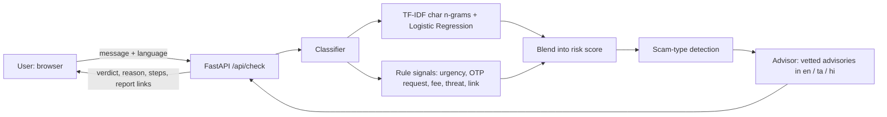
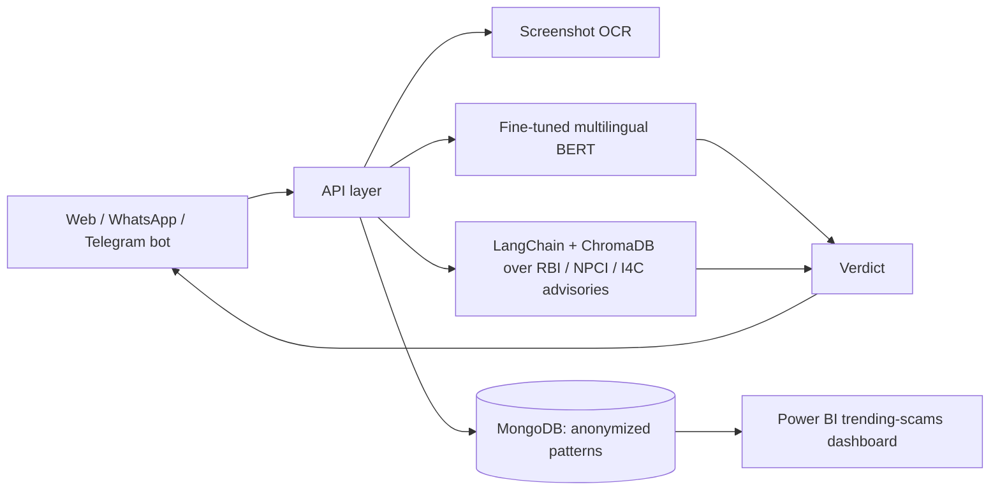

# Technical Design: ScamShield Bharat

## Current prototype

## Components
| Component | Role |
|---|---|
| `classifier.py` | Probability from the ML model (50%) plus rule score (50%). A strong rule score (>= 0.6) sets a floor, so obvious scams are not missed by a small model. Levels: high (>= 0.7), suspicious (>= 0.4), likely safe. |
| `advisor.py` | Looks up the explanation by scam type and language, plus three action steps and official reporting links. |
| `data/advisories.json` | Human-written explanations in English, Tamil and Hindi. Easy to review and extend. |
| `static/index.html` | Single-page UI with language selector. |

## Design choices
- **Character n-grams** avoid language-specific tokenizers and cope with mixed-script and transliterated text.
- **Rule signals are shown to the user**, which keeps the verdict explainable.
- **Advisories are human-written**, so the explanation text never depends on a model generating advice about money or safety.
- A genuine OTP message ("Your OTP is 123456. Do not share it") is treated as safe: the credential-request signal only fires when someone asks you to share or send the code.

## Target architecture (roadmap)

## Evaluation plan
- Hold-out test set: precision, recall, F1 per language.
- Latency target: verdict in under 5 seconds.
- Pilot with 20-30 people: share of scam messages correctly identified before vs after using the tool.

## Limitations
- Small sample dataset; accuracy figures from it are not meaningful.
- Rule patterns cover common Indian scam templates and will miss novel ones.
- Supports Tamil, Hindi and English only.
